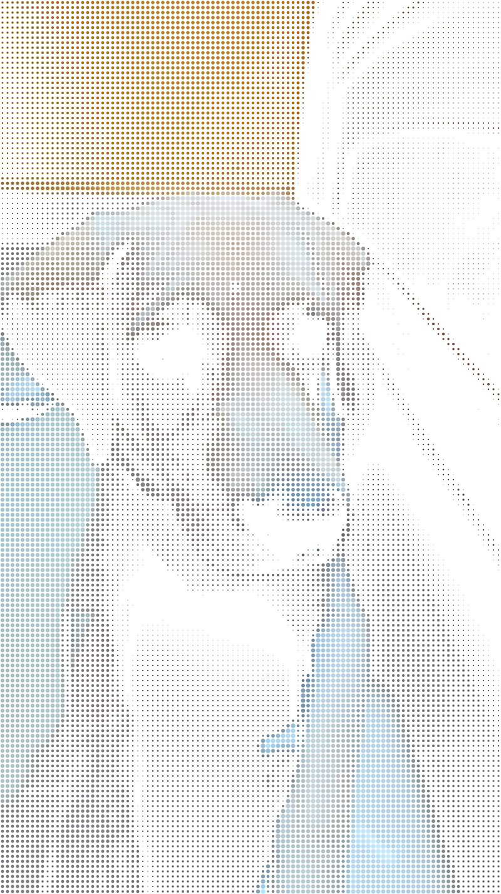
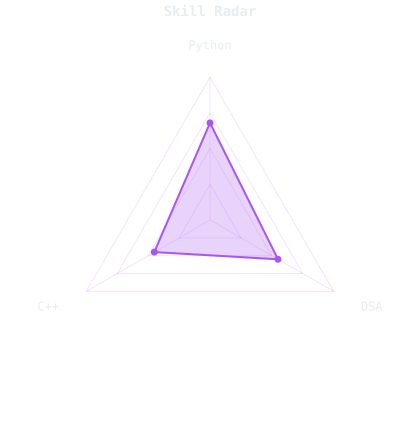
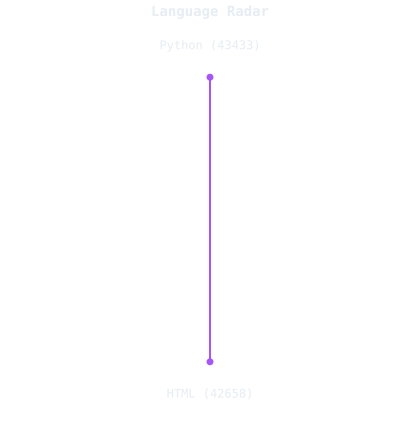
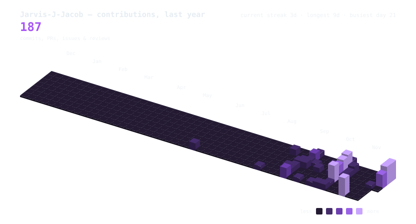
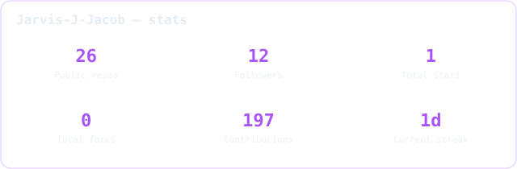

<picture>
  <source media="(prefers-color-scheme: dark)" srcset="assets/portrait.svg">
  <source media="(prefers-color-scheme: light)" srcset="assets/portrait.svg">
  
</picture>

 

## `~/` whoami

Hi, I'm **Jarvis**. I'm a student at Newton School of Technology, S-VYASA campus, currently spending most of my time getting better at building things and understanding how they work underneath.

- Building at hackathons with my team, and sending open-source PRs the rest of the time
- Competitive programming on **[Codeforces](https://codeforces.com/profile/3jz)**
- Learning **Contributing to OpenSource Projects**
- Fun fact: **My Real name is truly Jarvis**

## `~/` toolbox

 

## `~/` skill radar

One I rated myself. The other counts real language bytes across my public repos and redraws itself on a schedule.

<table><tr>
<td width="50%" align="center">
  <picture>
    <source media="(prefers-color-scheme: dark)" srcset="assets/radar-dark.svg">
    <source media="(prefers-color-scheme: light)" srcset="assets/radar-light.svg">
    
  </picture>
</td>
<td width="50%" align="center">
  <picture>
    <source media="(prefers-color-scheme: dark)" srcset="assets/radar-langs-dark.svg">
    <source media="(prefers-color-scheme: light)" srcset="assets/radar-langs-light.svg">
    
  </picture>
</td>
</tr></table>

 

## `~/` contribution calendar

<picture>
  <source media="(prefers-color-scheme: dark)" srcset="assets/isocal-dark.svg">
  <source media="(prefers-color-scheme: light)" srcset="assets/isocal-light.svg">
  
</picture>

  

<picture>
  <source media="(prefers-color-scheme: dark)" srcset="https://raw.githubusercontent.com/Jarvis-J-Jacob/Jarvis-J-Jacob/output/snake-dark.svg">
  <source media="(prefers-color-scheme: light)" srcset="https://raw.githubusercontent.com/Jarvis-J-Jacob/Jarvis-J-Jacob/output/snake-light.svg">
  
</picture>

both self-drawn from GitHub's own data, no third-party server: the calendar by <code>scripts/isocal.py</code> on every push (and daily), the snake by its workflow on every push (and twice daily). They 404 only until the first run.

 

## `~/` the numbers

This tracks activity, not ownership — so it's accurate even before there's a single repo of my own.

<picture>
  <source media="(prefers-color-scheme: dark)" srcset="assets/card-stats-dark.svg">
  <source media="(prefers-color-scheme: light)" srcset="assets/card-stats-light.svg">
  
</picture>

  

## `~/` hackathon projects

Team builds I co-developed. Both are hosted under a teammate's account.

<table>
<tr>
<td width="50%" valign="top">

### [Phantom](https://github.com/MassGethu/Phantom)
**Hacktoberfest 2026** — 4th place out of 70 teams NST Bengaluru at S-VYASA. 12-hour overnight build with team ULTRON.

A CLI that finds the setup steps a README forgets. It runs the README in a fresh Docker container, names what's missing, bisects history for the commit that broke setup, then patches the README and proves the fix works.

  

</td>
<td width="50%" valign="top">

### [Sabūt](https://github.com/MassGethu/Sabut)
**INNOVEX 2026** — results pending Smart Agriculture track. <a href="https://sabut.vercel.app/">Live demo</a>

Uses Sentinel-1 satellite radar to help agriculture officers decide which rice-incentive claims need a field visit. Includes an auditable review queue and a farmer correction flow in Hindi and Punjabi.

   

</td>
</tr>
</table>

 

the charts and cards above regenerate themselves on a schedule

